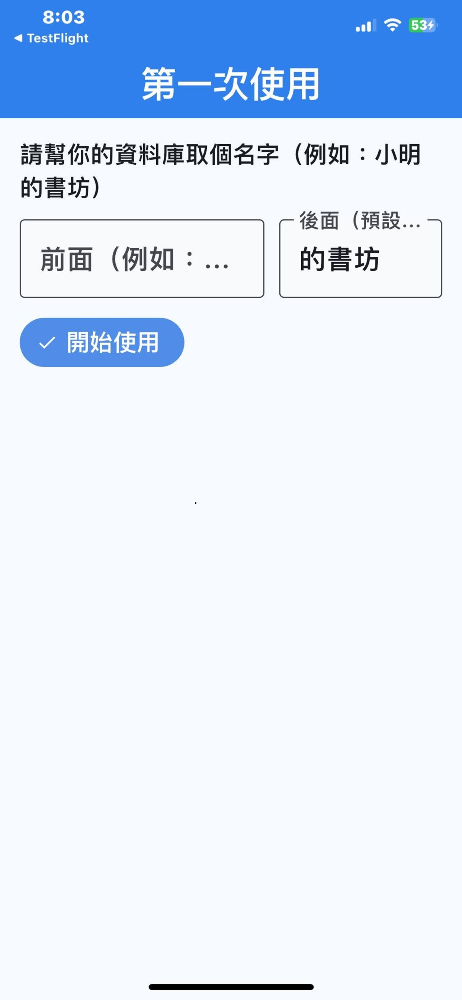
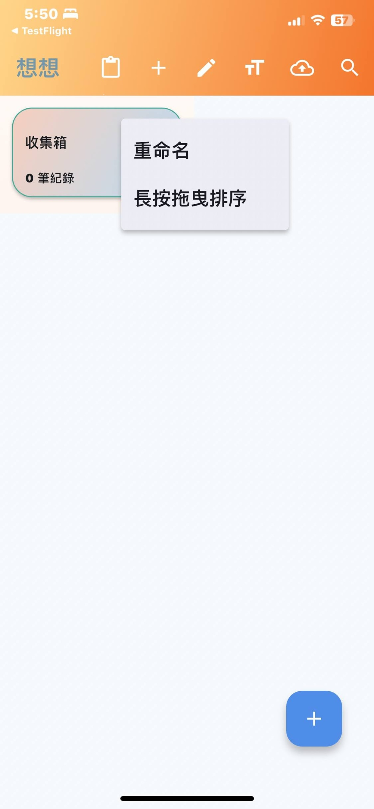
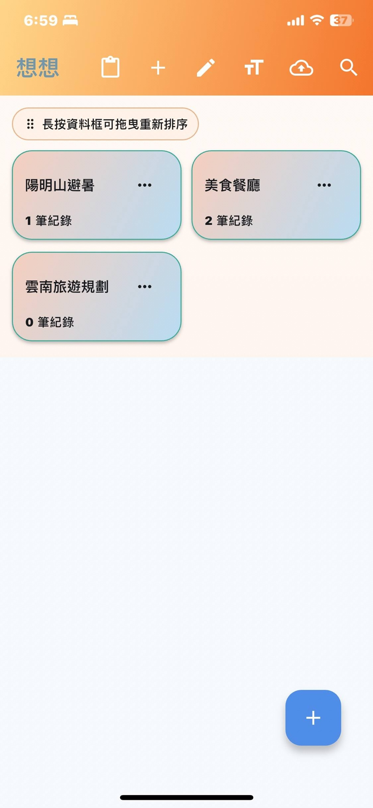
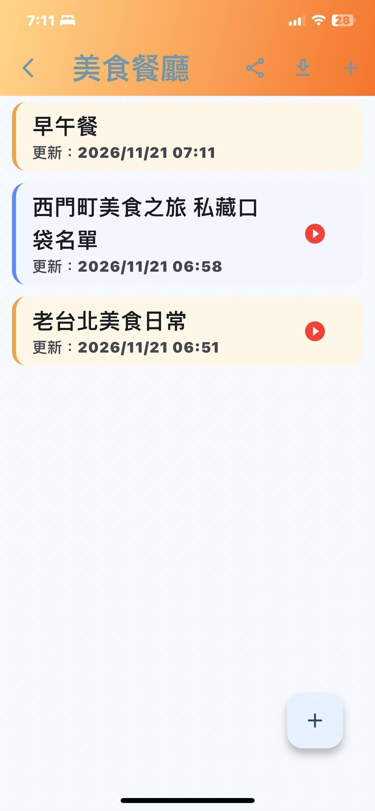
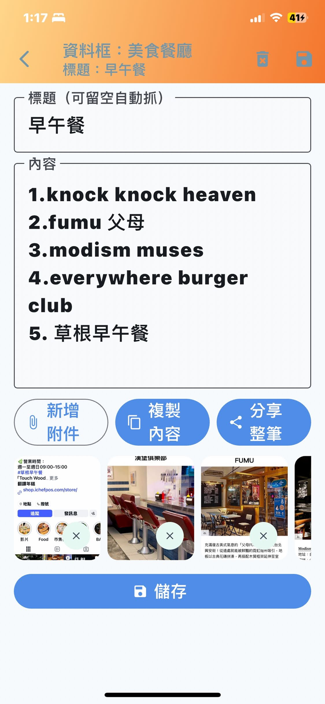
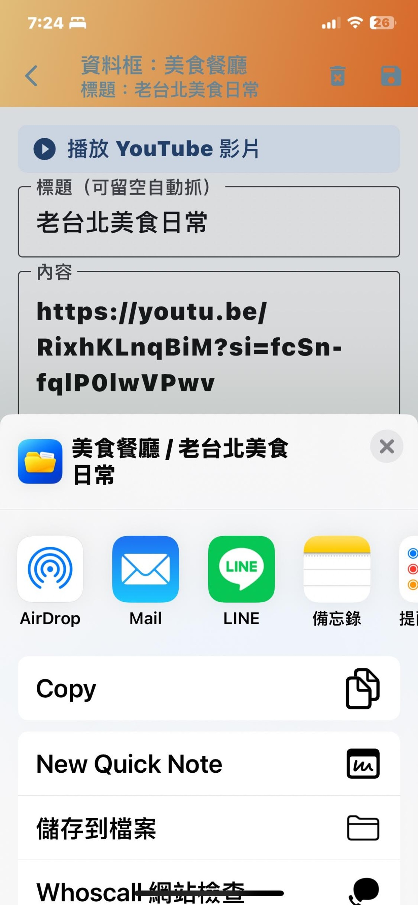

# MemoryOne 使用手冊與操作指南

歡迎使用 **MemoryOne**！這是一款專為簡單記錄生活、極簡分類與安心保存所設計的個人數位記憶庫。

---

## 🌟 1. 首次使用與個人化設定

當您第一次開啟 App 時，系統會引導您進行簡單的個人化設定：

1. **命名您的專屬資料庫**：
   * 在「前面」輸入您的姓名或暱稱（例如：`小明`）。
   * 後面預設為 `的書坊`（組合起來即為 `小明的書坊`）。
2. **開始使用**：
   * 輸入完成後點選 **「✓ 開始使用」**，即可進入您的個人主頁。

---

## 📁 2. 主頁與「資料框（分類）」管理

進入主頁後，您可以管理所有的分類區塊（資料框）：

| 分類選單與操作功能 | 主頁資料框排列預覽 |
| :---: | :---: |
|  |  |

* **新增資料框**：
  * 點選右上角的 **`+`** 圖示，建立新的分類（例如：`陽明山避暑`、`美食餐廳`、`雲南旅遊規劃`）。
* **編輯與重命名**：
  * 點選資料框右側的 **`...`** 選項選單。
  * 點選 **「重命名」** 修改分類名稱。
* **調整資料框順序**：
  * **長按資料框**即可直接拖曳重新排序，讓常用分類放在最順手的位置。
* **快捷與搜尋工具列**：
  * 點選上方剪貼簿圖示 **`📋`** 可進行快取操作，點選 **`🔍`** 可進行跨區塊搜尋。

---

## 📝 3. 檢視與管理筆記列表

點選進入任一「資料框」（例如：`美食餐廳`），即可查看與管理該分類下的筆記：

* **新增筆記**：
  * 點選右上角的 **`+`** 號或右下角的藍色 **`+`** 浮動按鈕。
* **檢視筆記資訊**：
  * 每筆紀錄皆會顯示標題與最後更新時間，若帶有語音或媒體播放內容會顯示播放按鈕。

---

## 📎 4. 新增與編輯筆記紀錄（含附件與連結）

在編輯筆記畫面中，您可以自由寫下內容並加入圖片或影片連結：

| 包含圖片附件與操作按鈕 | 支援 YouTube 影片播放連結 |
| :---: | :---: |
|  |  |

* **填寫筆記內容**：
  * **標題**：可自行輸入標題（若留空，系統會自動抓取第一行文字或連結標題）。
  * **內容**：輸入文字備忘、清單，或直接貼上網址。
* **加入與管理圖片附件**：
  * 點選左下角的 **`📎 新增附件`** 按鈕選擇照片。
  * 頁面下方會顯示圖片預覽縮圖，點選縮圖上的 **`X`** 可隨時移除該附件。
* **快捷功能按鈕**：
  * **`📋 複製內容`**：一鍵將筆記文字複製到剪貼簿。
  * **`🔗 分享整筆`**：將這筆筆記透過選單分享至其他 App。
* **播放 YouTube 影片**：
  * 若內容包含 YouTube 影片連結，點選上方 **`▶ 播放 YouTube 影片`** 即可直接觀看。
* **儲存變更**：
  * 編輯完成後，點選最下方的藍色 **`💾 儲存`** 按鈕即可完成儲存。

---

## 📲 5. 從 LINE 與其他 App 直接「分享進 App」

當您在 LINE 或瀏覽器看到想保存的資訊、网頁網址或文字時：

1. 點選該應用程式的 **「分享（Share）」** 按鈕。
2. 在選單中找到並點選 **「MemoryOne」**。
3. 選擇您要存入的「目標資料框」，系統會自動帶入內容並建立新筆記！

---

## 🔍 6. 跨區塊搜尋與資料備份

* **跨區塊搜尋**：
  * 點選主頁右上角的放大鏡 **`🔍`**，輸入關鍵字即可一次搜尋所有資料框內的筆記。
* **安全備份與匯出**：
  * 點選主頁上方的雲端 **`☁️`** 圖示，可將資料備份匯出或發送到 e-mail，方便換機時進行一鍵還原。